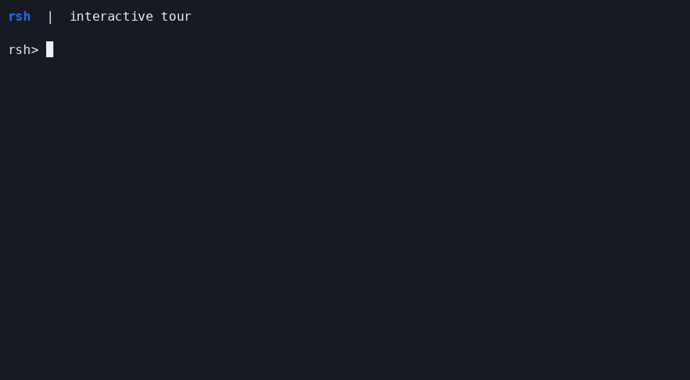

# rsh

A Unix shell written in Rust, combining POSIX-oriented scripting with a fish-inspired
interactive editor powered by [Reedline](https://github.com/nushell/reedline).
The language is shell syntax, not fish syntax. This project is unrelated to the
legacy remote-shell (`rsh`) network client.

## See rsh in action

A short, real terminal session: history suggestions, Tab completion, pipelines,
multiline conditions, functions, here-strings and exit-status feedback.



[Original asciicast recording](docs/demo/rsh.cast) · [Replay and re-recording guide](docs/demo/README.md)

To replay the recording in your terminal after cloning the repository:

```sh
asciinema play docs/demo/rsh.cast
```

The GIF plays directly in GitHub's README; the original recording preserves terminal
text and timing. Recording tools are optional and are not rsh runtime dependencies.

## Build and run

Supported targets are Linux and macOS. Build on the target operating system and
architecture; a macOS executable cannot run on Linux. Windows is not supported.
Use the current stable Rust toolchain, Cargo and a native linker/C build toolchain.
A C++ toolchain is additionally needed for the optional libFuzzer targets.

```sh
cargo build --release --locked --bin rsh
./target/release/rsh -c 'printf "%s\n" "hello from rsh"'
./target/release/rsh
```

The final command starts the editor when stdin is a terminal. To install the
executable in Cargo's bin directory (normally `~/.cargo/bin`):

```sh
cargo install --path . --locked --bin rsh
```

The shell itself does not require Python, dash or Bash. Those are test dependencies.
External commands still need to be installed and discoverable through `PATH`.

## Usage

```sh
rsh -c 'printf "%s\n" "$1"' example first-argument
rsh script.sh argument1 argument2
printf 'printf "hello\\n"\n' | rsh -s
rsh -n script.sh
rsh --dump-ast -c 'if true; then printf "yes\n"; fi'
rsh --vi --no-motd
```

| Option | Behavior |
| --- | --- |
| `-c command [arg0 [args...]]` | Run a command string; optional `arg0` becomes `$0`. |
| `-s [args...]` | Read commands from stdin. |
| `-e -u -x -f -n -C` | Enable errexit, nounset, tracing, noglob, parse-only or noclobber. |
| `-o name` | Enable a named option, for example `-o pipefail`. |
| `-i` | Request interactive mode; non-TTY stdin still uses script input. |
| `-l` | Set login mode; it does **not** load system/Bash profile files. |
| `--vi` | Use vi editing instead of the default Emacs bindings. |
| `--no-motd` | Skip the automatic startup message. |
| `--dump-ast` | Print the parsed AST without executing commands or startup files. |
| `--` | End option parsing, for example before a script named `-example`. |

Place startup options before `-c`; arguments after its command string are positional
arguments. There is currently no dedicated `--help` or `--version` command.

## Scripting features

- Structured words, quoting, variables, positional parameters, tilde/parameter/
  command/arithmetic expansion, IFS splitting and pathname matching.
- Ordered redirections, fd duplication/closing, here-documents and here-strings.
- Pipelines, `!`, `&&`/`||`, sequential/background lists and exit-status propagation.
- Brace groups, subshells, `if`, loops, `case` and recursive shell functions.
- Builtins for variables, control flow, file tests, formatted output, stdin reads,
  sourcing, traps, options and job management. `type` and `command -v` inspect lookup.
- Terminal job control with `jobs`, `fg`, `bg`, `wait`, `kill` and `disown`.

Selected extensions include `<<<`, `[[ ... ]]`, opt-in `pipefail` and a subset of
`shopt`. The supported shopt names are `dotglob`, `expand_aliases`, `failglob`,
`nocasematch`, `nullglob` and `sourcepath`. Unsupported names report an error.
See [compatibility and validation](docs/CONFORMANCE.md) for the exact scope.

## Startup configuration

**Every top-level invocation loads configuration, including `-c`, scripts and piped
stdin.** Only `${XDG_CONFIG_HOME:-$HOME/.config}/rsh` is scanned, recursively; the
current working directory is never scanned. Files whose names end with the literal
lowercase suffix `rsh` are sourced in byte-sorted full-path order. Internal pipeline,
subshell and command-substitution workers inherit state without loading it again.

A small configuration might be:

```sh
mkdir -p "$HOME/.config/rsh"
cat > "$HOME/.config/rsh/00-user.rsh" <<'EOF_CONFIG'
# Put interactive-only output/settings behind an interactive check.
case $- in
    *i*)
        alias ll='ls -l'
        set -o git_prompt
        ;;
esac
EOF_CONFIG
```

`config.sh` is not auto-loaded; use `config.rsh`. Neither login mode nor ordinary
startup implicitly reads `/etc/profile`, `~/.profile`, `~/.bashrc`, `ENV` or `BASH_ENV`.
Do not source an arbitrary `.bashrc` expecting full Bash compatibility.

Explicit sourcing accepts any pathname, with no extension requirement:

```sh
source settings.rsh        # Current directory, without PATH lookup by default.
. ../shared/settings       # Relative path.
source /absolute/settings  # Absolute path.
shopt -s sourcepath        # Opt into PATH-first lookup for slashless source names.
```

Read [configuration and interactive use](docs/CONFIGURATION.md) for file ordering,
scoped arguments, prompt/history options, motd and login behavior.

## Interactive use

The editor provides syntax highlighting, history suggestions, prefix history search,
Tab completion, reverse search, bracketed paste and multiline continuation. Emacs
bindings are the default; vi is opt-in. Suggestions can be accepted with Right or End,
and Ctrl-R searches history. An incomplete command prompts for more input; Ctrl-C
clears the current input and Ctrl-D on empty input exits, subject to stopped-job warnings.

History defaults to `${XDG_DATA_HOME:-$HOME/.local/share}/rsh/history`; `HISTFILE`,
`HISTSIZE` and `HISTFILESIZE` customize it. A leading space omits an entry from history.
`TERM=dumb` or unset `TERM` uses a plain terminal reader instead of the editor.

## Development and tests

```sh
cargo fmt --all -- --check
cargo clippy --all-targets -- -D warnings
cargo test
cargo run --bin spec-runner -- verify-references
cargo run --bin spec-runner -- run
```

Install Python 3.9+, dash and Bash to run the complete test infrastructure. PTY tests
need a host that permits pseudo-terminals, signals and child-process management.
CI covers Linux and macOS and repeats editor/job-control PTY tests to detect races.
A passing local run does not certify all POSIX behavior or complete the outstanding
manual checks.

- [Contributing](CONTRIBUTING.md): setup, verification and review conventions.
- [Architecture](docs/ARCHITECTURE.md): module boundaries and execution invariants.
- [Conformance](docs/CONFORMANCE.md): reports, reference differences and test limits.
- [Fuzzing](fuzz/README.md): lexer/parser targets and reproducible smoke runs.
- [Manual terminal checks](tests/pty/MANUAL.md): visual and real-terminal checks.
- [Specification and milestones](SPEC.md): grammar, semantics and implementation status.

## License

Licensed under the [Apache License, Version 2.0](LICENSE). Dependencies retain their
own licenses; see their package metadata when redistributing a build.
