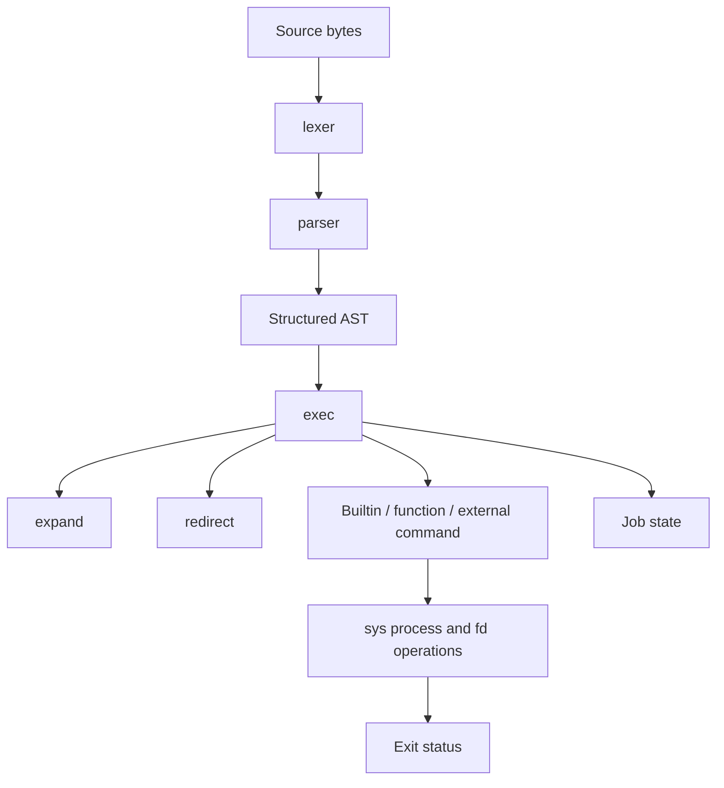

# Architecture

rsh is one Rust package containing the `rsh` library and shell executable.
`spec-runner` and `spec-sandbox` are test-infrastructure binaries, not part of
ordinary shell dispatch. Public Rust module APIs are currently experimental.

## Pipeline through the interpreter

| Module | Responsibility |
| --- | --- |
| `lexer` | Byte tokens, physical spans, quotes/substitution bodies, queued here-documents. |
| `parser` | Recursive-descent grammar, contextual keywords/aliases, incomplete vs syntax errors. |
| `ast` | Plain structured words and commands, canonical source serialization and debug dumps. |
| `expand` | Execution-time expansion, quote tracking, splitting, pathname/pattern matching and arithmetic. |
| `exec` | Dispatch, control flow, functions, source/eval/exec and orchestration of child processes. |
| `redirect` | Expand-independent redirection plans and fd reservation analysis. |
| `builtins` | Builtin lookup and implementations; interpreter-dependent operations delegate to exec. |
| `env` | Variables/attributes, positional parameters, logical cwd, options and worker snapshots. |
| `jobs` | Jobs, process states, current/previous markers and job-spec resolution. |
| `sys` | Safe boundaries for raw OS process, fd, signal, terminal, regex and identity operations. |
| `interactive` | Startup configuration, Reedline integration, history, highlighting and completion. |
| `main` | Arguments, top-level modes and restoration of internal worker state. |

## Words, parsing and serialization

Words hold `WordPart` values instead of pre-expanded strings. Quote boundaries survive
until execution. Expansion tracks which bytes are quoted and eligible for splitting;
pattern/regex expansion preserves those boundaries as well. Filename and variable
values use bytes/OS strings, rather than requiring UTF-8.

Reserved words are contextual. `[[ ... ]]` has its own conditional AST and grammar;
`&&` inside it does not become an outer command list. Here-document bodies are
collected after the triggering newline and associated with their delimiters in order.

`Script::to_source_bytes()` is the lossless byte serialization used by workers and
roundtrip tests. `Display` is a readable UTF-8 preview and may be lossy for non-UTF-8
input. Physical line metadata is preserved separately across worker serialization.

## Execution and state ownership

The executor dispatches special builtins, functions, regular builtins, then external
commands. Control-flow values (`Break`, `Continue`, `Return`, `Exit`) unwind shell
constructs without Rust panics. Functions share variables but restore scoped
arguments/assignments. ShellEnv's cwd and variables are logical shell state; the
parent does not change Rust's process-global cwd/environment for every command.

The executor runs serially. Separate Shell values are not a promise of safe concurrent
execution: descriptors, signals and terminal ownership belong to the OS process.
The editor's bounded completion workers synchronize fd-owning scans with execution
so redirections cannot replace a descriptor still owned by a scanner.

## Process and descriptor invariants

`PreparedProcess` owns C strings, argv/env pointer storage, redirection operations
and diagnostic buffers prepared before fork. The child path in sys performs only
async-signal-safe operations and exec/_exit, without Rust formatting, allocation,
locking or unwinding. Shell logic needed in a subshell or pipeline is executed by
re-execing rsh first, then restoring an internal snapshot. Internal worker switches
are an implementation protocol, not a supported command-line interface.

Snapshots include variables, options, functions, positional parameters and metadata.
They travel over an inherited descriptor rather than argv, avoiding ARG_MAX for large
shell values. Workers inherit shell state but do not repeat user startup loading.

Redirections apply left to right. External commands apply them in the child;
current-shell commands use a guard that saves originals in high CLOEXEC descriptors
and restores them on success or error. `exec` without a command deliberately commits
its descriptor changes. Hidden internal fds move away from user-accessed numbers.

Small here-documents use a prefilled pipe no larger than the guaranteed pipe capacity.
Larger bodies use a temporary file unlinked immediately. Command substitution uses
file-backed capture, waits/reaps the worker, then reads its output; it does not wait
for a child that is blocked on a full unread capture pipe.

## Signals and jobs

Signal handlers only record pending state. The shell reaps owned children and runs
traps outside handlers. Background polling must not steal foreground wait statuses.
Monitored pipelines share a process group; parent/child setpgid and launch barriers
coordinate terminal handoff. The terminal guard restores ownership/modes after stop,
completion and error. Exit with remaining interactive jobs follows the documented
HUP-then-CONT policy unless a job is exempt/disowned.

## Bounds and limitations

The lexer/parser cap recursive nesting at 64; active function calls are limited to
32 and in-process AST evaluation depth to 128. Conditional expressions additionally
limit non-grouping tokens to 64. These are implementation limits, not POSIX grammar
rules. Other bounded operations include printf output/width, history size, completion
scans and motd reads. Reaching a defined bound returns an error instead of intentionally
panicking. This does not imply a globally sandboxed or memory-bounded interpreter.

See [SPEC](../SPEC.md) for exact contracts and [conformance](CONFORMANCE.md) for what
has actually been tested.
